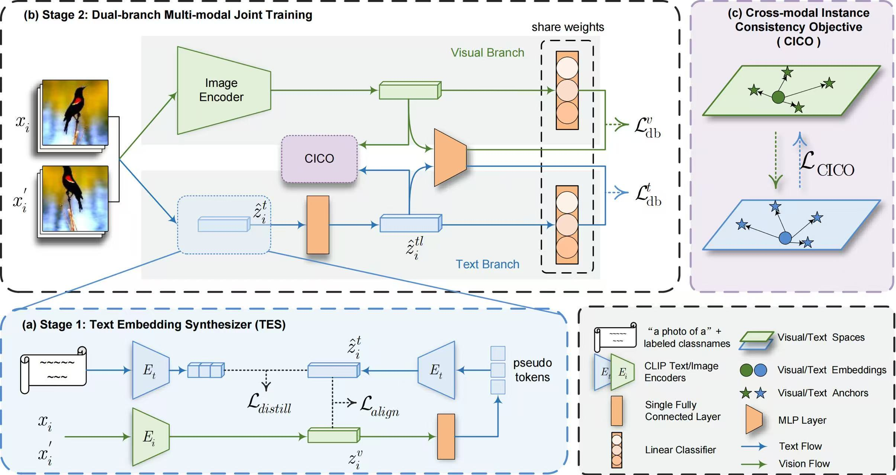

# Vision-to-Text Embedding Synthesis for Generalized Category Discovery (V2T-GCD)


## 📖 Introduction



Given unlabelled datasets containing both old and new categories, generalized category discovery (GCD) aims to accurately discover new classes while correctly classifying old classes.  Current GCD methods only use a single visual modality of information, resulting in a poor classification of visually similar classes. 
As a different modality, text information can provide complementary discriminative information, motivating its use in the GCD task.
However, the lack of class names for unlabelled data makes it impractical to utilize text information.
To tackle this problem, V2T-GCD uses a Text Embedding Synthesizer (TES) to generate pseudo text embeddings for unlabelled samples. TES leverages the property 
that CLIP can generate aligned vision-language features, 
converting visual embeddings into tokens of the CLIP’s text 
encoder to generate pseudo text embeddings. Besides, we employ a dual-branch framework, through the joint learning and instance consistency of different modality branches, visual
and semantic information  mutually enhance each other,
promoting the interaction and fusion
of visual and text knowledge.
V2T-GCD unlocks the multi-modal potential of CLIP and outperforms baseline methods by a
large margin on all GCD benchmarks, achieving new state-of-the-art.


## 🚀 Getting Started

### 1. Datasets

We use the standard benchmarks in this paper, including:

* Generic datasets：[CIFAR-10/100](https://pytorch.org/vision/stable/datasets.html) and [ImageNet-100/1K](https://image-net.org/download.php)

* Fine-grained datasets: [The Semantic Shift Benchmark (SSB)](https://github.com/sgvaze/osr_closed_set_all_you_need#ssb) and [Herbarium19](https://www.kaggle.com/c/herbarium-2019-fgvc6)

### 2. Dependencies

```
pip install -r requirements.txt
```

### 3. Config

Set paths to datasets and desired log directories in ```config.py```


### 4. Train the model

Train V2T-GCD on the Stanford Cars dataset: 

```
bash scripts/run_scars.sh
```


